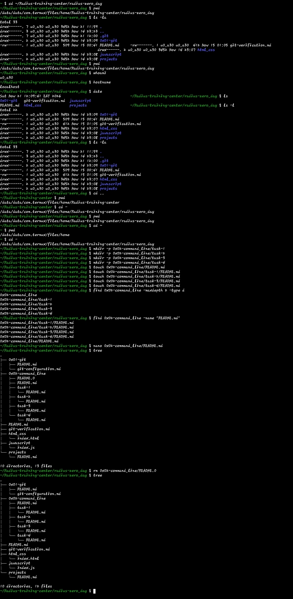

# Task 1: Linux Terminal Navigation & Environment Exploration

# Commands I practised

- `pwd`
- `whoami`
- `hostname`
- `date`
- `ls`
- `ls -l`
- `ls -la`
- `cd`
- `cd ..`
- `cd -`
- `cd ~`
- `mkdir -p`
- `touch`
- `find`
- `rm`
- `tree`

# Explanation of the commands

- `pwd` prints the current working directory.
- `whoami` shows the current user.
- `hostname` shows the machine name.
- `date` shows the current date and time.
- `ls` lists files and folders.
- `ls -l` lists them in long format, with permissions, owner and size.
- `ls -la` also shows hidden files such as `.git`.
- `cd <path>` moves into a directory using an absolute or relative path.
- `cd ..` goes up one level.
- `cd -` returns to the previous directory.
- `cd ~` goes to the home directory.
- `mkdir -p` creates nested directories in one step.
- `touch` creates empty files.
- `find` locates files and directories by name or type.
- `rm` removes a file. I used it to delete a misspelled `README.0`.
- `tree` displays the directory structure.

# What I learned

- I can move around the filesystem using absolute and relative paths.
- `cd -` and `cd ~` let me jump between locations quickly.
- `ls -la` shows permissions, owners and hidden files.
- I created the `0x02-command_line` structure with `mkdir -p` and `touch`.
- I verified the final structure with `find` and `tree`.

# Screenshot

