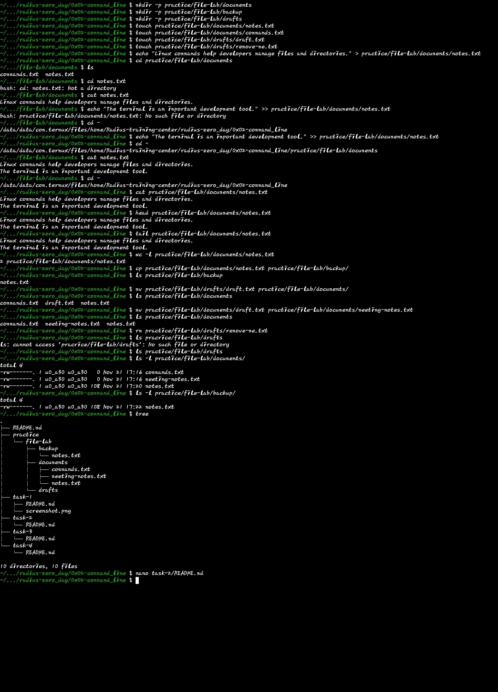

# Commands I practised under Task 2

- `mkdir -p`
- `touch`
- `echo >`
- `echo >>`
- `cat`
- `tail`
- `head`
- `wc -l`
- `cp`
- `mv`
- `rm`
- `ls -l`

# Explanation of each command in detail

- `mkdir -p` creates nested directories. The `-p` option creates parent folders as needed and does not give an error if the folder already exists.
- `touch` creates an empty file.
- `echo >` writes text to a file and replaces the old contents with the new text.
- `echo >>` appends new text to the end of a file and keeps the older content.
- `cat` displays the whole content of a file.
- `tail` displays the last 10 lines of a file.
- `head` displays the first 10 lines of a file.
- `wc -l` counts the lines in a file. (`wc -w` counts words.)
- `cp` copies a file from one place to another.
- `mv` has two purposes: it moves files and it renames them.
- `rm` deletes a file. `rm -rf` deletes a folder with all its content, so use it carefully.
- `ls -l` lists the content of a folder in long format, which lets us see file permissions.

# Difference between `>` and `>>`

- `>` overwrites the file and replaces the old content.
- `>>` appends to the end of the file and keeps the old content.

# File permissions

- `ls -l` showed `-rw-------` for my files.
- The owner can read and write.
- The group and others have no access.
- No file had the execute (`x`) permission, so running `notes.txt` as a command gave "Permission denied".

# Screenshot

