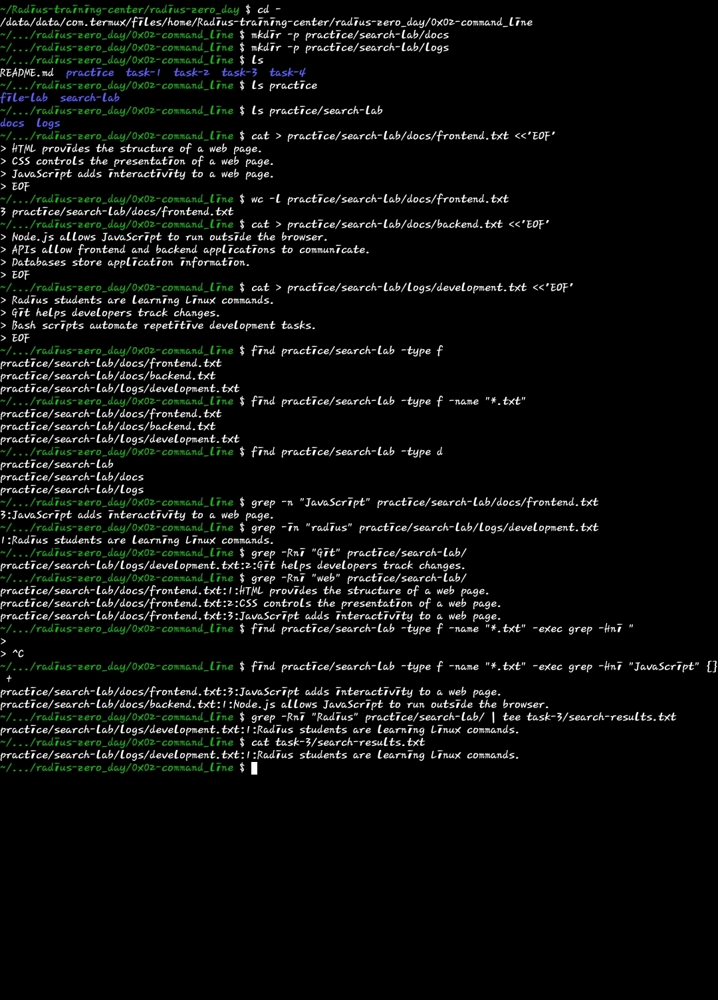

# Task 3: Finding Files & Searching File Contents

# Purpose of `find`

- `find` locates files and directories by name, type or location.
- `find practice/search-lab -type f` lists all files.
- `find practice/search-lab -type f -name "*.txt"` lists only `.txt` files.
- `find practice/search-lab -type d` lists only directories.

# Purpose of `grep`

- `grep` searches inside files for text that matches a word or pattern.
- It prints each matching line.
- `grep -n "JavaScript" practice/search-lab/docs/frontend.txt` shows matches with line numbers.
- `grep -Rni "Git" practice/search-lab/` searches all files in a folder, ignoring case.

# Difference between finding a filename and searching inside a file

- `find` works on names and types. It tells me where a file is.
- `grep` works on content. It tells me which lines inside a file contain a word.
- `find` can locate `frontend.txt` without opening it. `grep` opens the file and reads its lines.

# Combined `find` and `grep` command

- `find practice/search-lab -type f -name "*.txt" -exec grep -Hni "JavaScript" {} +`
- `find` selects only regular files whose names end in `.txt`.
- `-exec` runs `grep` on the files that were found. `{}` stands for those files.
- `-H` shows the file name, `-n` shows the line number, and `-i` ignores case.
- `+` passes many files to one `grep` run, which is faster.
- Result: `JavaScript` was found in `frontend.txt` (line 3) and `backend.txt` (line 1).

# Saved output

- `grep -Rni "Radius" practice/search-lab/ | tee task-3/search-results.txt` shows the matches and also saves them in `search-results.txt`.

# Screenshot

