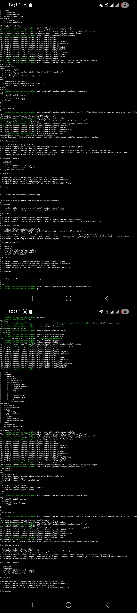

# Task 4: Bash Scripting - Automated Website Project Generator

# Purpose

- `create_website.sh` generates a basic website project automatically.
- It saves me from creating the same folders and files by hand each time.

# How to use

- Make it executable: `chmod +x task-4/create_website.sh`
- Default location: `./task-4/create_website.sh` creates `~/radius-projects/website-project/`.
- Custom location: `./task-4/create_website.sh "$HOME/radius-projects/custom website"` creates the project there.

# How the script works

- It starts with the shebang `#!/bin/bash`.
- `PROJECT_DIR="${1:-$DEFAULT_DIR}"` uses the first argument, or the default if none is given.
- All variables are quoted, so paths with spaces work.
- It checks whether the destination exists. If it does, it prints an error and stops with `exit 1` without changing anything.
- It creates `css/`, `js/` and `images/`, then writes `index.html`, `css/style.css`, `js/script.js` and a README in the root and in each folder.
- It finishes by printing the full path of the generated project.

# Generated structure

- `README.md`
- `index.html`
- `css/` with `README.md` and `style.css`
- `js/` with `README.md` and `script.js`
- `images/` with `README.md`

# Tests I ran

- Default location: the project was created and `find` listed all files.
- Custom location with a space in the path: the project was created correctly.
- Existing directory: the script printed an error and stopped.
- Verified the HTML, CSS and JavaScript with `cat`, and the READMEs with `find`.

# Screenshot

